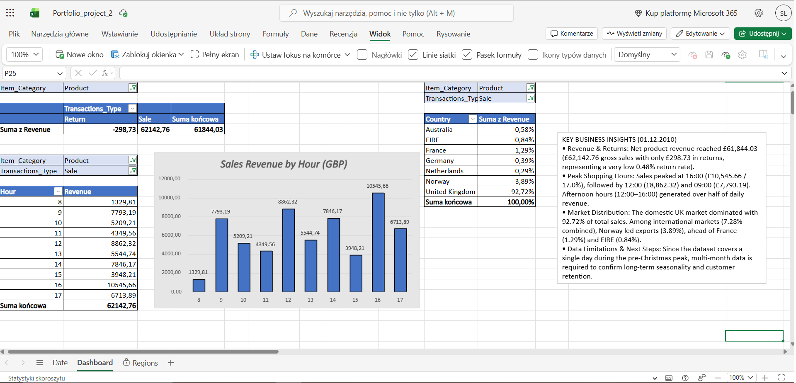
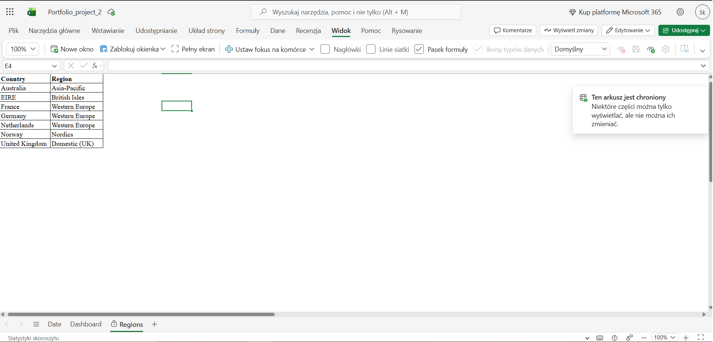
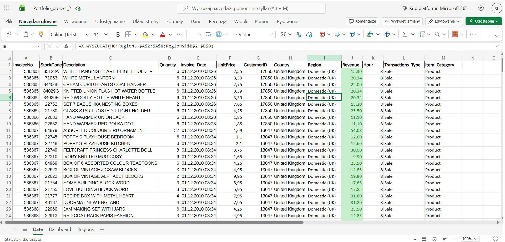
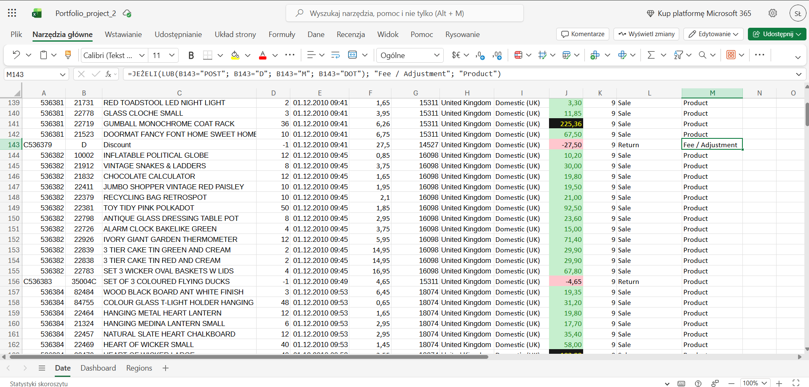
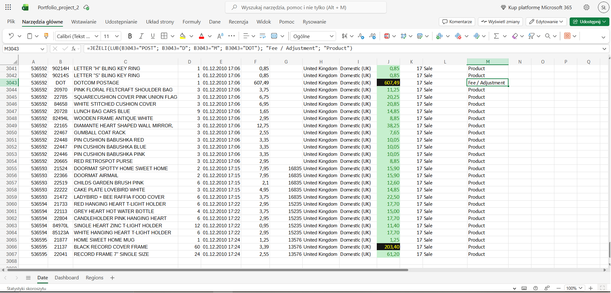

# UK Online Retail Sales Analysis – Microsoft Excel

## 1. Business Problem & Project Goal
The objective of this project was to analyze raw Point-of-Sale (POS) and e-commerce transaction data from a UK-based online retail store (sourced from the IBM Customer POS Analytics dataset, covering ~3,400 transaction records starting from December 2010). Raw transactional logs require proper validation, handling of returns/cancellations, and aggregation to uncover purchasing patterns.

**Key Project Objectives:**
- Clean and validate raw retail transaction records in **Microsoft Excel**.
- Calculate key sales metrics (Total Revenue, Order Volume, Average Basket Value).
- Build dynamic **Pivot Tables** and **Charts** to analyze sales distribution by country, top-selling products, and customer behavior.

## 2. Data Cleaning & Preparation (Excel)
Before building reports, the raw dataset (`Online Retail Sample.csv`) underwent structured preparation:
- **Data Formatting & Structure:** Converted raw CSV data into a structured Excel Table, standardizing date formats (`InvoiceDate`) and currency formatting (`UnitPrice`).
- **Handling Cancellations & Anomalies:** Identified and separated/filtered canceled orders (invoices prefixed with `'C'` and negative `Quantity` values) and zero-price records so they would not distort gross revenue metrics.
- **Missing Values Check:** Audited missing `CustomerID` records to distinguish between registered customer purchases and guest checkouts.
- **Feature Engineering:** Added calculated columns such as **Total Line Revenue** (`Quantity * UnitPrice`), as well as extracted date attributes (Date/Hour) to examine peak shopping times.

## 3. Analytical Methods Used
- **Excel Formulas:** `SUMIFS`, `COUNTIFS`, `IF`, `ROUND`, `TEXT`, `XLOOKUP` / `VLOOKUP`.
- **Pivot Tables & Slicers:** Multi-dimensional aggregation by `Country`, `Description` (Product), and `CustomerID` with interactive filtering.
- **Data Visualization:** Bar charts, line trends, and KPI summary cards designed for quick executive reading.

## 4. Key Business Insights
- **Geographic Concentration:** The vast majority of orders and revenue originate from the **United Kingdom**, with international sales concentrated in key European markets (e.g., Germany, France, EIRE, Netherlands).
- **Top-Performing Products:** A small group of giftware and home decor items drives a disproportionate share of total order volume.
- **Order Cancellations & Returns:** Tracking negative quantities (`InvoiceNo` starting with `C`) revealed return rates that directly impact net revenue.
- **Customer Purchasing Patterns:** Repeat business customers place bulk orders with significantly higher Average Order Value (AOV) compared to single-item retail buyers.

## 5. Excel Dashboard & Analysis Previews

### Executive Dashboard

### Regional Sales Breakdown

### Data Preparation & Pivot Tables

